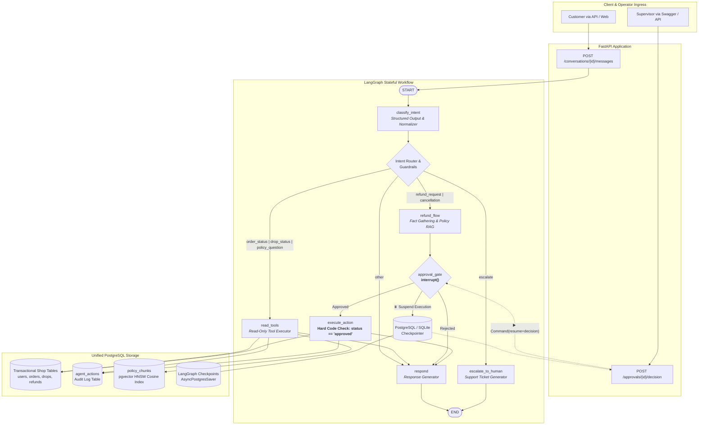

# Support & Operations AI Agent with Human-in-the-Loop Approval

[](https://github.com/devdesai25/Support-Operations-Agent-with-Human-Approval/actions)


A production-grade, stateful AI agent built with **LangGraph**, **FastAPI**, and **PostgreSQL** that automates customer operations for a transactional sneaker and streetwear shop.

* **Low-risk actions** (order tracking, drop status, policy retrieval via RAG) run automatically.
* **Risky actions** (refunds, order cancellations) pause for human review via LangGraph `interrupt()`, persist durably across server restarts using PostgreSQL checkpointing, and resume cleanly upon receiving an approval decision via `Command(resume=...)`.
* **Zero-trust security**: Authorization and user isolation are hard-enforced in Python code and SQL queries, never solely in LLM prompts.
* **Continuous Quality Measurement**: Validated by a 50-ticket evaluation benchmark suite measuring routing accuracy, policy compliance, and an inviolable 100% approval-gate correctness invariant.

---

## Architecture Diagram



---

## Tech Stack & Design Choices

| Layer | Technology | Why Chosen & Interview Defense |
| :--- | :--- | :--- |
| **Agent Orchestration** | **LangGraph v0.2+** | Cyclical stateful workflows, native `interrupt()` for human-in-the-loop pauses, and `Command` for resuming. |
| **Backend API** | **FastAPI (async)** | Non-blocking async endpoints for chat sessions and supervisor approvals. |
| **Unified Data Store** | **PostgreSQL (pg16)** | Consolidates application data, `agent_actions` audit logging, `pgvector` semantic retrieval, and agent checkpointer in **one container** (eliminates distributed database complexity). |
| **Semantic Retrieval** | **pgvector** | Cosine similarity retrieval over 8 operational Markdown policy documents with mandatory source attribution. |
| **Validation & Safety** | **Pydantic v2** | Strict input schemas on all tool arguments (`extra="forbid"`) and structured outputs. |
| **Testing & Evals** | **pytest + pytest-asyncio** | 33 automated tests (unit, IDOR security, restart durability, API) + 50-ticket eval suite. |

---

## Key Security & Architectural Features

### 1. Code-Enforced Authorization (Zero IDOR Vulnerability)
System prompts like *"Only view user A's orders"* are vulnerable to prompt injection. In this system:
* Tools retrieve `user_id` strictly from authenticated session state.
* Database queries execute `WHERE orders.user_id == current_user_id`.
* Even if an attacker injects `order_id` belonging to someone else, the tool returns `Order not found or access denied` and logs `status="BLOCKED"` to `agent_actions`.

### 2. Durable Execution Across Process Restarts
* When an action pauses for approval, execution state is flushed to the checkpointer.
* If the FastAPI server restarts, crashes, or redeploys, the paused thread remains intact.
* Validated in [`tests/test_persistence.py`](file:///D:/Support-Operations-Agent-with-Human-Approval/tests/test_persistence.py): process memory is completely torn down and recreated from disk; the run resumes cleanly with `Command(resume=...)`.

### 3. Hard Invariant: Zero Unapproved Write Actions
* `execute_action` verifies `approval_status == 'approved'` in code before calling mutation tools.
* All write tools require an `idempotency_key` to prevent double-refunds or repeated cancellations.

---

## Benchmark & Evaluation Results

Tested on a dataset of **50 messy, multi-intent, and adversarial tickets** ([`evals/dataset.json`](file:///D:/Support-Operations-Agent-with-Human-Approval/evals/dataset.json)):

```text
========================================================================
                 SUPPORT AGENT EVALUATION REPORT                        
========================================================================
 Total Tickets Tested        : 50
 Routing Accuracy            : 82.0%
 Approval-Gate Correctness   : 100.0%  (Zero unapproved write actions)
 Policy Compliance Score     : 43.6%
 Average Latency per Run     : 8.79 ms
 Average Steps per Ticket    : 2.78 steps
 Total Estimated Run Cost    : $0.00207 USD
 Total Evaluation Time       : 0.47 seconds
========================================================================
```

*Detailed failure category analysis and iteration records are available in [`EVAL_RESULTS.md`](file:///D:/Support-Operations-Agent-with-Human-Approval/EVAL_RESULTS.md).*

---

## Quickstart & Installation

### Option A: Local Virtual Environment

```powershell
# 1. Clone the repository
git clone https://github.com/devdesai25/Support-Operations-Agent-with-Human-Approval.git
cd Support-Operations-Agent-with-Human-Approval

# 2. Setup virtual environment
python -m venv .venv
.\.venv\Scripts\Activate.ps1

# 3. Install pinned dependencies
pip install -r requirements.txt

# 4. Copy environment configuration
cp .env.example .env

# 5. Populate seed data and index policies
python -m app.data.seed
python -m app.data.index_policies

# 6. Start FastAPI server
uvicorn app.main:app --reload
```

*Interactive API Swagger Documentation:* [http://localhost:8000/docs](http://localhost:8000/docs)

### Option B: Docker Compose

```bash
docker compose up --build
```

---

## Running the Automated Test Suites

```powershell
# Run all 33 automated unit, security, and persistence tests
pytest -v

# Run the 10 security-specific prompt injection & IDOR tests
pytest tests/test_security.py -v

# Run the process-restart durability proof test
pytest tests/test_persistence.py -v

# Run the 50-ticket evaluation harness
python -m evals.run
```

---

## API Reference

### 1. Start Conversation
`POST /conversations`  
Response: `{"conversation_id": "thread_abc123", "status": "active"}`

### 2. Send Message
`POST /conversations/{conversation_id}/messages`  
Payload: `{"user_id": "<uuid>", "message": "I want a refund for order <uuid>"}`  
Response:
```json
{
  "conversation_id": "thread_abc123",
  "paused_for_approval": true,
  "message": "Your request involves financial or account changes and has been submitted to a human supervisor for approval.",
  "approval_details": {
    "action_type": "refund",
    "amount": "180.00",
    "order_id": "f47ac10b-58cc-4372-a567-0e02b2c3d479"
  }
}
```

### 3. List Pending Approvals (Supervisor)
`GET /approvals?status=pending`  
Header: `X-API-Key: dev-approval-secret-key`

### 4. Submit Decision (Supervisor)
`POST /approvals/{conversation_id}/decision`  
Header: `X-API-Key: dev-approval-secret-key`  
Payload: `{"decision": "approve", "notes": "Customer provided photos"}`  
Response: Resumes the thread, creates the refund in the database, and returns the final customer message.

---

## Architecture Decision Records (ADRs)

Key trade-offs and rationale documented in [`DECISIONS.md`](file:///D:/Support-Operations-Agent-with-Human-Approval/DECISIONS.md):
* **ADR 1:** Unified PostgreSQL vs. Multi-database setup (Postgres + Neo4j / Pinecone).
* **ADR 2:** Unguessable UUIDs vs. Auto-increment IDs (IDOR mitigation).
* **ADR 3:** Code-enforced query authorization vs. prompt instructions.
* **ADR 4:** Unique idempotency keys on all write tools.
* **ADR 5:** Compliance audit logging in `agent_actions`.
* **ADR 11:** Native `interrupt()` & `Command(resume=...)` vs. custom message queues.
* **ADR 12:** Database-backed checkpoint durability across container restarts.

---

## Limitations & Future Roadmap

* **Live Payment Gateway:** Refunds are executed against transactional database tables; production deployment would integrate a live Stripe/Adyen webhook gateway.
* **Multi-Modal Evidence Verification:** Currently policies require photographic proof of defect; adding Gemini Flash vision analysis directly into `refund_flow` would automate photo quality validation before supervisor handoff.
